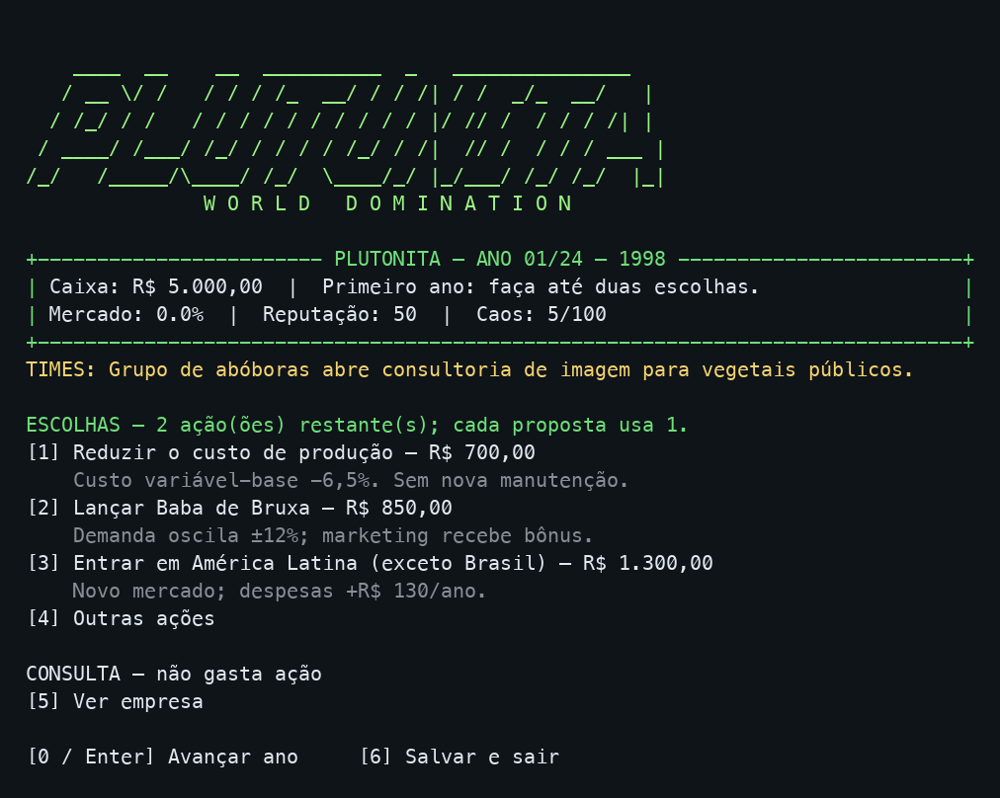
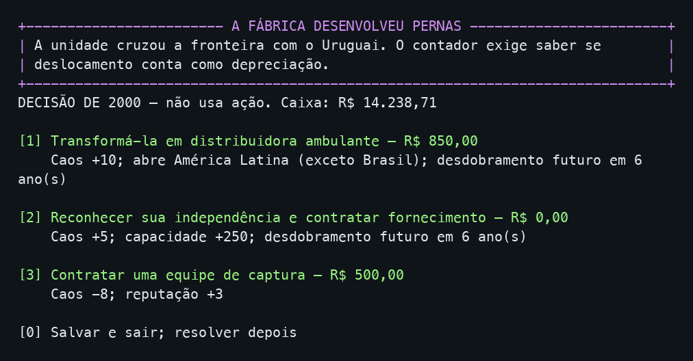
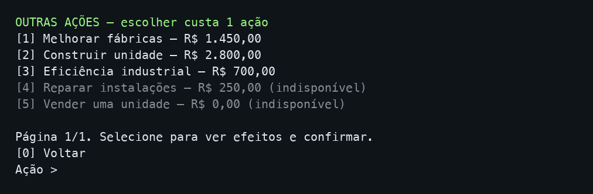
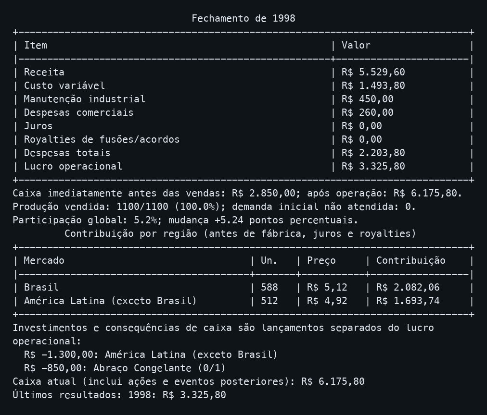
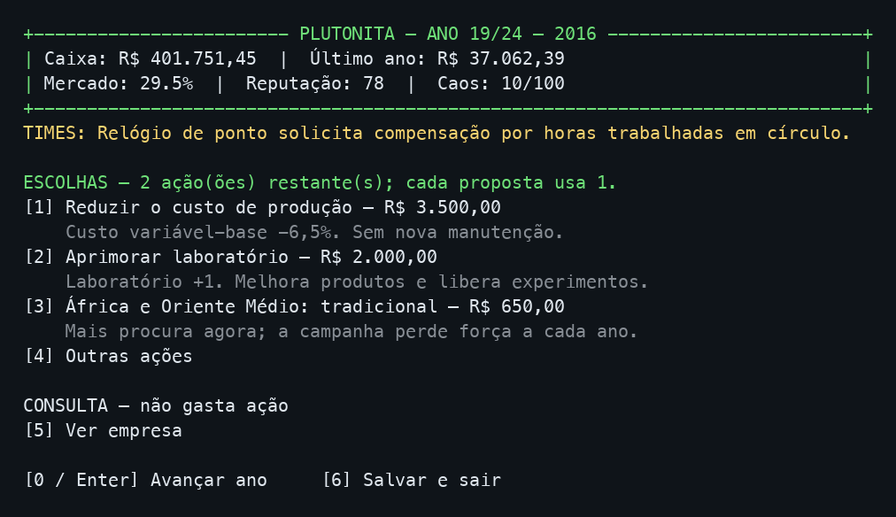
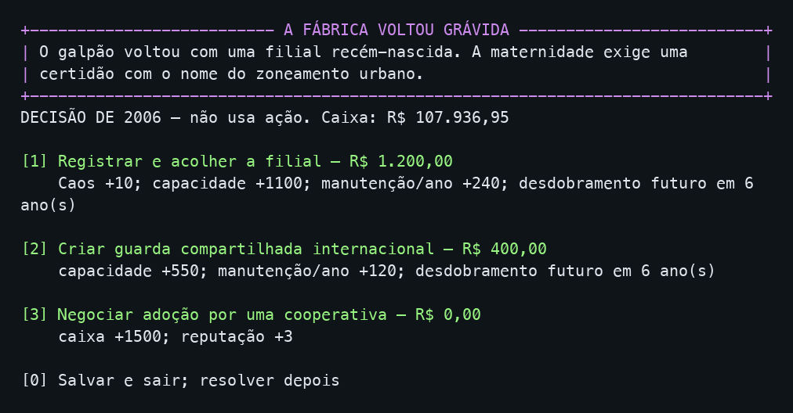
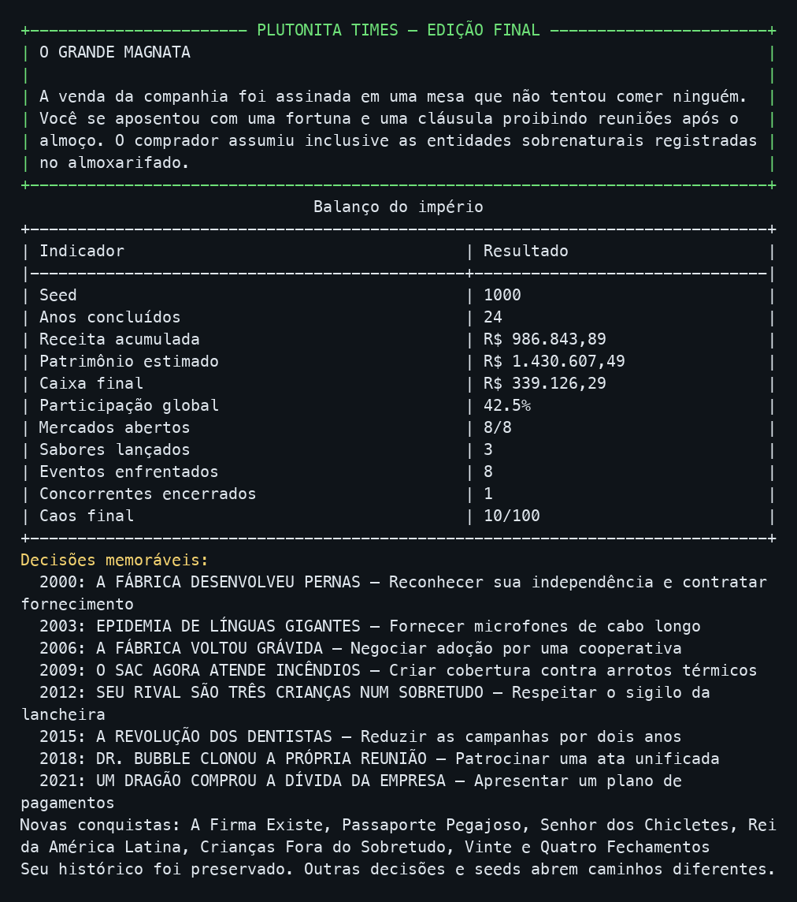

<p align="center">
  <strong>Capitalismo, chicletes e decisões empresariais questionáveis.</strong><br>
  Um tycoon de terminal em que o maior problema da sua fábrica pode ser ela ir embora.
</p>

<p align="center">
  
  
  
  
</p>

<p align="center">
  <a href="#jogar">Jogar</a> ·
  <a href="#o-terminal-do-fim-do-mundo">Ver as telas</a> ·
  <a href="docs/GUIA_DO_JOGADOR.md">Guia do jogador</a> ·
  <a href="BALANCEAMENTO.md">Testes e balanceamento</a>
</p>

---

## Você herdou uma fábrica. Ela ainda não sabe disso.

**Brasil, 1998.** O fundador desapareceu depois de mascar o protótipo do **Sabor Definitivo**. Sobrou um galpão enferrujado, **R$ 5.000** e uma substância verde que o contador insiste em chamar de funcionário.

Você tem **24 anos** para construir um império de chicletes. Invista na produção, descubra sabores, abra mercados e enfrente três rivais que também querem dominar o planeta.

Só não se surpreenda quando a sua fábrica desenvolver pernas e atravessar a fronteira com o Uruguai. Isso, segundo o financeiro, é um problema de logística.

> **URGENTE: A FÁBRICA DESENVOLVEU PERNAS.**  
> Capturar a instalação, transformá-la em distribuidora ambulante ou reconhecer sua independência?  
> Escolha com cuidado. Anos depois, ela pode voltar grávida.

## Um pequeno negócio. Oito mercados. Nenhum juízo.

| Na planilha | Fora da realidade |
|---|---|
| **2 ações por ano** para investir, pesquisar, expandir e negociar | **53 grandes eventos** com três escolhas e consequências concretas |
| **8 mercados** com preços, preferências e concorrência próprios | **4 histórias encadeadas** que lembram das suas decisões |
| **3 empresas rivais** com caixa, fábricas e estratégias reais | **Caos Corporativo de 0 a 100**, independente da reputação |
| **7 sabores clássicos** e até três linhas ativas | Um laboratório de fórmulas como **Sabor Terça-Feira** e **Buraco Negro** |
| Relatórios que explicam receita, custos e lucro | **60 notícias**, de boletins econômicos a burocracia sobrenatural |
| Salvamento automático, seeds e histórico | **11 finais**, **20 conquistas** e cosméticos desbloqueáveis |

**Duração desejada: cerca de 10–15 minutos.** Sem cronômetro, animações demoradas ou obrigação de consultar relatórios a cada turno. Esse ritmo é uma meta de design, ainda sujeita a testes com jogadores.

## Jogar

Você precisa de **Python 3.11+** e de um terminal. Clone o projeto:

```bash
git clone https://github.com/ESAran/Plutonita-World-Domination.git
cd Plutonita-World-Domination
```

Instale a dependência e abra a diretoria:

```bash
python3 -m pip install -r requirements.txt
python3 main.py
```

No Windows, use `python` ou `py` no lugar de `python3`. Depois da instalação, **o jogo funciona offline**. Os rivais usam regras locais, sem IA externa ou serviços pagos.

<details>
<summary><strong>Prefere instalar em um ambiente virtual?</strong></summary>

```bash
python3 -m venv .venv
source .venv/bin/activate
python -m pip install -r requirements.txt
python main.py
```

No Windows, ative com `.venv\Scripts\activate` no Prompt de Comando ou `.venv\Scripts\Activate.ps1` no PowerShell.

</details>

```bash
python3 main.py --seed 1000       # Reproduza a seed dos prints
python3 main.py --resume          # Retome sua campanha
python3 main.py --no-color        # Desative as cores
```

A seed define os sorteios; **suas escolhas também mudam os resultados**. Para reproduzir uma campanha, mantenha seed, configuração, versão e decisões iguais.

## Sua primeira reunião de diretoria

1. **Escolha entre três propostas.** Cada uma mostra custo e efeito; você pode tomar duas decisões por ano.
2. **Consulte a empresa se precisar.** Um resumo direto mostra produção, resultados, sabores e mercados.
3. **Aperte Enter para avançar.** Depois das duas ações, as opções de investimento desaparecem e o ano está pronto para fechar.
4. **Enfrente o inesperado.** A cada três anos, uma grande decisão pode mudar o rumo da empresa.

| Tecla | Função |
|---|---|
| `1` a `3` | Executar uma das propostas disponíveis (1 ação) |
| `4` | Outras ações: produção, marketing, pesquisa, expansão e negociação |
| `5` | Ver empresa; ajustes gratuitos e arquivo completo |
| `6` | Salvar e sair da campanha |
| `0` ou `Enter` | Avançar o ano; nos submenus, voltar |

**A tela é limpa a cada troca de menu**, mantendo o visual e o Caos Corporativo. Gastos importantes e decisões narrativas pedem confirmação. Ctrl+C também tenta salvar. Para manter a saída acumulada, use `--no-clear`; redirecionamentos para arquivo não recebem comandos de limpeza.

A campanha vai de **1998 a 2021**. Receita, manutenção, juros e consequências usam períodos anuais. O Halloween é agregado em cada ano, sem exigir administrar meses separadamente.

## O terminal do fim do mundo

As imagens abaixo são renderizações da **interface real**, capturadas na mesma campanha, com a seed `1000`. O banner do topo é arte promocional original; o jogo em si usa texto, tabelas e cores.

**Começa com um galpão e dois pontos de ação.**



**Depois, o patrimônio começa a atravessar fronteiras por conta própria.**



<details>
<summary><strong>Mais telas: produção, finanças e crescimento</strong></summary>

### Cada investimento tem um preço



### Cada resultado tem uma explicação



### O galpão pode virar um império



</details>

<details>
<summary><strong>Spoilers: uma consequência seis anos depois e um possível final</strong></summary>





</details>

## Escolha seu tipo de problema

**Construa uma empresa sólida.** Equilibre capacidade, preço, eficiência e demanda. Fábricas ociosas custam dinheiro; clientes sem produto podem comprar dos rivais. Cresça com reputação e presença internacional.

**Entre na guerra corporativa.** Dispute mercado com a **GomaMax**, a **SweetCorp International** e a **Dr. Bubble Industries**. Distribuição, espionagem fictícia, sabotagens absurdas, aquisições e fusões custam dinheiro — e podem provocar respostas.

**Financie o inexplicável.** Misture acidez, temperatura, efervescência e estranheza. Caos alto abre oportunidades e histórias próprias. Não é derrota automática; também não isenta ninguém de pagar manutenção.

**Descubra outro final.** Você pode dominar o mercado mundial, construir uma marca querida, enriquecer ou ajudar a fundar uma república de chicletes. Também pode falir. O jogo não esquece as decisões que levaram até lá.

### O cardápio da diretoria

**Língua Ácida · Baba de Bruxa · Dentada Ardente · Abraço Congelante · Cabeça de Abóbora · Mordida de Zumbi · Atomic Mistério**

Cada clássico tem pesquisa, custo, afinidades e eventos próprios. No laboratório, as receitas experimentais dependem da combinação escolhida, do nível de pesquisa e de uma variação controlada pela seed.

## Sua campanha não desaparece junto com o fundador

O jogo salva depois de ações, configurações, fechamentos e decisões narrativas. Em `saves/` ficam a campanha e o perfil, com conquistas, recordes e finais encontrados. O salvamento preserva inclusive o gerador aleatório e as consequências ainda agendadas.

Para manter outra campanha separada:

```bash
python3 main.py --save-dir saves/outra-campanha
```

Os cosméticos desbloqueados mudam a apresentação. Eles não concedem vantagem econômica permanente.

## O contador pediu evidências

**42 testes automatizados**, uma bateria registrada de **600 campanhas** e dois cenários dirigidos acompanham o código. Todos os 53 eventos apareceram na bateria; os 11 finais foram alcançados na soma das simulações e dos cenários dirigidos.

```bash
python3 -m unittest discover -s tests -v
python3 tools/simulate.py --campaigns 600 --output reports/minha_simulacao.json
python3 tools/scenarios.py
```

Os testes verificam capacidade, dinheiro, concorrentes, eventos, finais, saves, seeds e navegação. **Simulação não substitui teste humano de diversão.** A bateria principal foi tolerante à falência; o cenário de investimento improdutivo demonstra uma derrota financeira por escolhas legais.

[Ver resultados e limitações de balanceamento →](BALANCEAMENTO.md)

## Para quem também quer mexer na caldeira

- **[Guia do jogador](docs/GUIA_DO_JOGADOR.md):** instalação detalhada, sistemas, opções e salvamento.
- **[Guia de sistemas](docs/SISTEMAS.md):** fórmulas, arquitetura narrativa e condições dos finais. Contém spoilers.
- **[Balanceamento](BALANCEAMENTO.md):** dados, decisões e limites das simulações.
- **[Progresso](PROGRESS.md):** registro da implementação e verificações.
- **[Arte do header](assets/README.md):** origem, ferramenta e prompt da imagem promocional.

O motor fica em `plutonita/`, os menus em `plutonita/ui/` e os catálogos em `plutonita/data/`. O balanceamento aceita um JSON próprio via `--balance arquivo.json`, sem editar o Python para configurar uma partida comum.

Execução validada em Python 3.12 no macOS, com sintaxe compatível com 3.11 e layouts de 48/80 colunas. A duração real e a experiência em Windows/Linux ainda precisam de validação manual.

---

**Projeto de fã independente e não oficial, sem vínculo com a Arcor.** Não utiliza arquivos de arte, embalagens ou logotipos proprietários da marca. Os atributos estratégicos, personagens, fenômenos e situações empresariais são fictícios. A ilustração do header foi criada especificamente para este projeto com auxílio de geração de imagens.

<p align="center"><em>O departamento financeiro informa: dominar o mundo não dispensa a emissão de nota fiscal.</em></p>
